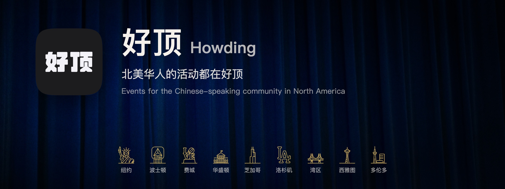
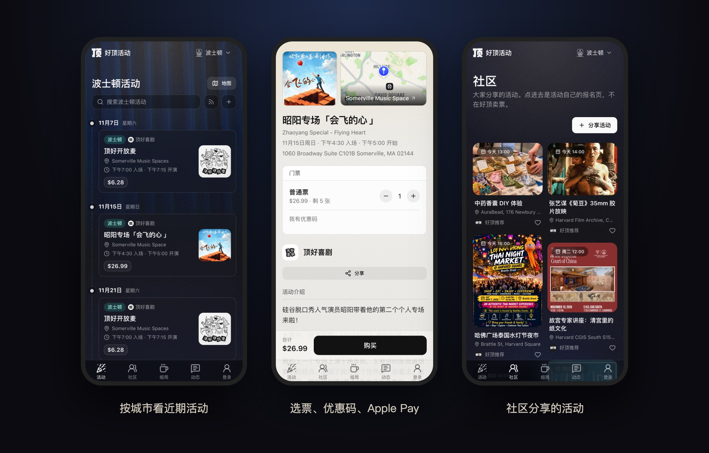
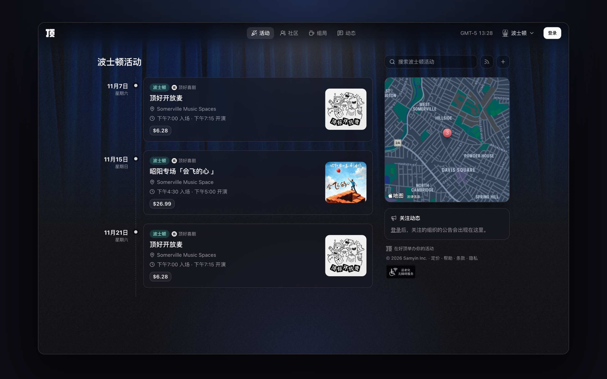

  

  <a href="https://howding.com"><b>howding.com</b></a> ·
  <a href="https://howding.com/pricing">主办方定价</a> ·
  <a href="https://howding.com/help">帮助中心</a> ·
  <a href="mailto:hello@samyin.com">hello@samyin.com</a>

---

**好顶**是北美华人的活动平台：纽约、波士顿、费城、华盛顿、芝加哥、洛杉矶、湾区、西雅图、多伦多的中文脱口秀、演出、讲座、市集和聚会，按城市看近期活动，Apple Pay 买票，扫码入场。

*Howding is an event platform for the Chinese-speaking community in North America — discover events by city, buy tickets with Apple Pay, and check in with a QR code. Organizers get ticketing, check-in and payments in one place.*

  

## 🎟️ 我们在做什么

| 给观众 | 给主办方 | 给社区 |
|---|---|---|
| 按城市发现活动、关注主办方 | 几分钟建好组织和活动 | 动态、评论和点赞 |
| Apple Pay 买票，票存进 Apple Wallet | 票种、优惠码、审核报名 | 组局：约咖啡、约饭、打球、爬山 |
| 我的票、自助退票 | 检票、Tap to Pay 现场收款 | 社区分享好活动 |
| 一个账号走遍所有组织 | 会员、群发、数据报表，钱直接进自己的 Stripe | 开发者 API 和嵌入组件 |

  

## 🛠️ 项目

| 仓库 | 内容 |
|---|---|
| **howding-web** | howding.com 网站和后端 · Cloudflare Workers、React、Supabase、Stripe Connect |
| **howding-ios** | 好顶 iOS App · SwiftUI |

仓库是私有的。成员 fork 之后提 PR 到 `staging` 分支，在 stage 环境验证后再上线。

## 👋 加入我们

我们是一个小团队，在找对活动、社区和产品有热情的人：**工程、设计、运营、内容**都欢迎。

想加入的话，写信到 **[hello@samyin.com](mailto:hello@samyin.com)**，简单介绍你自己和想做的事，有作品或 GitHub 的话附上链接。

好顶由 Samyin Inc. 开发和运营。
